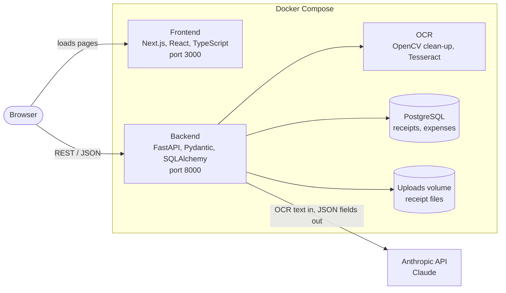

# Receipt Tracker

<!-- After pushing to GitHub, replace YOUR-USERNAME below and the badge shows whether the checks pass. -->
[](https://github.com/YOUR-USERNAME/receipt-tracker/actions/workflows/ci.yml)

A web app that turns a photo of a receipt into a tracked expense. Upload a
receipt, the app reads it with OCR, an LLM pulls out the merchant, date, tax
and total, you check the result, and it is saved to a searchable list with a
spending dashboard.

## Screenshots

<!--
Add four screenshots to docs/screenshots/ with these file names, then delete
this comment block's opening and closing lines so the images show.

| Upload | Review |
|---|---|
|  |  |

| Expenses | Dashboard |
|---|---|
|  |  |
-->

_Screenshots to add: `docs/screenshots/upload.png`, `review.png`, `expenses.png`, `dashboard.png`._

## What it does

- **Upload** a JPG, PNG or PDF receipt by drag and drop.
- **OCR** reads the text. The image is cleaned first (grayscale, resize,
  denoise, threshold, deskew) so photos taken at an angle or in poor light
  still read well.
- **An LLM extracts the fields**: merchant, date, subtotal, tax, total,
  currency and a category. Its reply must match a fixed schema and is
  validated before anything is stored.
- **Review** the extracted fields beside the receipt image, fix anything
  that is wrong, and save. The app flags totals that do not add up.
- **Expenses** list with month and category filters, edit, delete and CSV export.
- **Dashboard** with this month's total, spending by category, a six-month
  trend and top merchants.
- **Evaluation script** that measures extraction accuracy on a labelled set
  of receipts, with and without image preprocessing.

## How it works



What happens when a receipt is uploaded:

1. The browser sends the file to `POST /receipts`.
2. The backend checks the file's real type and size, saves it under a random
   name, and creates a `Receipt` row with status `pending`.
3. OpenCV cleans the image and Tesseract reads the text.
4. The text goes to Claude with a prompt and a JSON schema. The reply is
   validated with Pydantic. If it is invalid the backend asks once more, then
   marks the receipt `failed` with a readable message.
5. A sanity check compares subtotal + tax with the total (within $0.02) and
   adds a warning if they disagree.
6. The Review page shows the receipt and the fields. Saving creates an
   `Expense` and records whether the user changed what the AI read.

## Tech stack

| Part | Tools |
|---|---|
| Frontend | Next.js (App Router), React, TypeScript (strict), Tailwind CSS, Recharts |
| Backend | Python 3.12, FastAPI, Pydantic v2, SQLAlchemy 2.0, Alembic |
| Database | PostgreSQL 17 |
| OCR | Tesseract (pytesseract) with OpenCV preprocessing, behind a small interface |
| LLM | Anthropic Python SDK, structured JSON output |
| Tests | pytest, Vitest, React Testing Library |
| Tooling | Docker Compose, GitHub Actions, ruff, ESLint, openapi-typescript |

## Run it

You need [Docker Desktop](https://www.docker.com/products/docker-desktop/) and
an [Anthropic API key](https://console.anthropic.com/).

```bash
git clone https://github.com/YOUR-USERNAME/receipt-tracker.git
cd receipt-tracker

# Create your local settings file, then paste your API key into it.
cp .env.example .env

docker compose up
```

| What | Address |
|---|---|
| The app | http://localhost:3000 |
| API documentation (interactive) | http://localhost:8000/docs |
| Health check | http://localhost:8000/health |

The first start takes a few minutes while Docker builds the images. Database
migrations run automatically. Without an API key everything still works except
the AI extraction: receipts are saved and you can type the details by hand.

## API

| Method | Path | Purpose |
|---|---|---|
| POST | `/receipts` | Upload a file, run OCR and extraction |
| GET | `/receipts/{id}` | A receipt with its extracted fields and warnings |
| POST | `/receipts/{id}/extract` | Run the extraction again on the stored OCR text |
| GET | `/receipts/{id}/image` | The receipt image (`?processed=true` for the cleaned version) |
| POST | `/expenses` | Create an expense |
| GET | `/expenses` | List expenses, filter with `?month=YYYY-MM&category=` |
| GET, PUT, DELETE | `/expenses/{id}` | Read, change or delete one expense |
| GET | `/expenses/export.csv` | Download the filtered expenses as CSV |
| GET | `/stats/summary` | Totals for the dashboard |
| POST | `/auth/register` | Create an account and log it in |
| POST | `/auth/login` | Log in; the session token comes back in an HttpOnly cookie |
| POST | `/auth/logout` | End the current session |
| GET | `/auth/me` | The logged-in user, or 401 |

Every `/receipts`, `/expenses` and `/stats` endpoint needs a login and works
only on the logged-in user's own rows.

The frontend's TypeScript types are generated from the backend's OpenAPI
schema (`npm run generate:api`), so the two sides cannot drift apart silently.

## Tests and checks

```bash
# Backend: lint, formatting, tests
docker compose exec backend ruff check .
docker compose exec backend ruff format --check .
docker compose exec backend pytest

# Frontend: lint, type check, tests
docker compose exec frontend npm run lint
docker compose exec frontend npm run typecheck
docker compose exec frontend npm test
```

The backend tests run against a separate PostgreSQL database. OCR and the LLM
are replaced by fakes, so the tests are fast, free and need no API key.
GitHub Actions runs all of the above on every push
([workflow](.github/workflows/ci.yml)).

## Evaluation

`python -m app.eval` runs the full pipeline on a folder of labelled receipts
and reports accuracy per field. Dates, tax and totals must match exactly;
merchant names use a fuzzy match. A receipt the pipeline cannot process counts
as wrong for every field. See [eval/README.md](eval/README.md) for the label
format.

```bash
# Try it on the five made-up sample receipts in the repository
docker compose exec backend python -m app.eval --dir /eval/sample

# Run it on your own labelled receipts in eval/receipts/
docker compose exec backend python -m app.eval
```

### Results

<!--
Fill this in from the summary table that `python -m app.eval` prints for YOUR
receipts in eval/receipts/. Do not use the numbers from the sample set: those
five receipts are synthetic and too easy.
-->

Evaluated on **__ receipts** (my own photos, hand-labelled) with model
`claude-haiku-5-5` on **YYYY-MM-DD**.

| Field | With preprocessing | Without preprocessing |
|---|---|---|
| Merchant (fuzzy match) | __ % | __ % |
| Date (exact) | __ % | __ % |
| Tax (exact) | __ % | __ % |
| Total (exact) | __ % | __ % |
| Category | __ % | __ % |
| All fields correct | __ % | __ % |
| Average time per receipt | __ s | __ s |

_What the numbers show, in a sentence or two: to be written._

## Project structure

```
receipt-tracker/
├── compose.yaml            three services: postgres, backend, frontend
├── .env.example            settings template (copy to .env)
├── backend/
│   ├── app/
│   │   ├── main.py         creates the FastAPI app
│   │   ├── auth.py         password hashing, login sessions, current user
│   │   ├── routers/        the HTTP endpoints
│   │   ├── schemas/        Pydantic request and response shapes
│   │   ├── models/         SQLAlchemy database tables
│   │   ├── ocr/            image loading, preprocessing, Tesseract
│   │   ├── extraction/     prompt, Claude client, validation, sanity checks
│   │   └── eval/           the evaluation script
│   ├── alembic/            database migrations
│   └── tests/
├── frontend/
│   └── src/
│       ├── app/            pages (Upload, Review, Expenses, Dashboard, Log in, Sign up)
│       ├── components/     React components and their tests
│       └── lib/            API client, generated types, formatting helpers
├── eval/                   test receipts, labels and results
└── .github/workflows/      CI
```

## Design decisions

- **Money is never a float.** Amounts are `NUMERIC` in PostgreSQL, `Decimal`
  in Python and strings in JSON, so cents are never lost to rounding.
- **The LLM's output is not trusted.** It must match a JSON schema, is
  validated again by Pydantic, gets one retry, and the model is told to
  return null instead of guessing. Receipt text is passed as data inside
  tags, so text printed on a receipt cannot act as instructions.
- **OCR and the LLM sit behind small interfaces.** Tests swap in fakes, and a
  different OCR engine or model provider would be a one-file change.
- **A failed receipt is still saved**, with a status and a message, so the
  user can retry or type the details in by hand.
- **`was_edited` is decided by the server**, by comparing what was saved with
  what the AI extracted. It shows how often the AI needed correcting.
- **Passwords and session tokens are stored only as hashes.** Passwords use
  Argon2. A login is a random token in an HttpOnly cookie, and the database
  keeps its SHA-256, so logging out really ends the session and a leaked
  database cannot be used to log in.
- **The browser cannot read the login.** The cookie is HttpOnly, so the
  frontend asks `GET /auth/me` who is signed in and shares the answer through
  a React context. Sending signed-out visitors to the log-in page is done in
  the browser for convenience only; the backend is what enforces access.
- **Each user sees only their own data.** Receipts and expenses carry a
  `user_id` taken from the login session, never from the request, and every
  query filters on it. Asking for someone else's row gives the same 404 as a
  row that does not exist.
- **Secrets stay out of the repository.** The API key and model name come
  from environment variables; `.env` is gitignored.

## Known limitations

- Single user, no login.
- Saving the same receipt twice creates two expenses.
- The dashboard totals one currency at a time (CAD by default).
- OCR is set up for English, and HEIC photos must be converted to JPG first.
- The Docker setup is for development (hot reload), not a production deployment.
